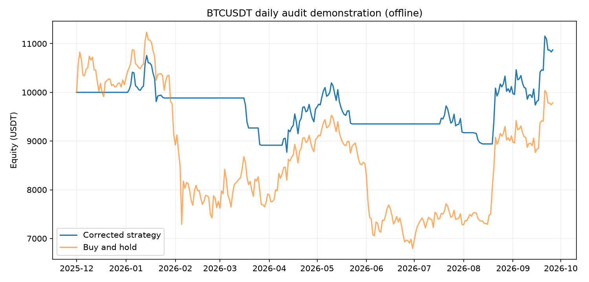
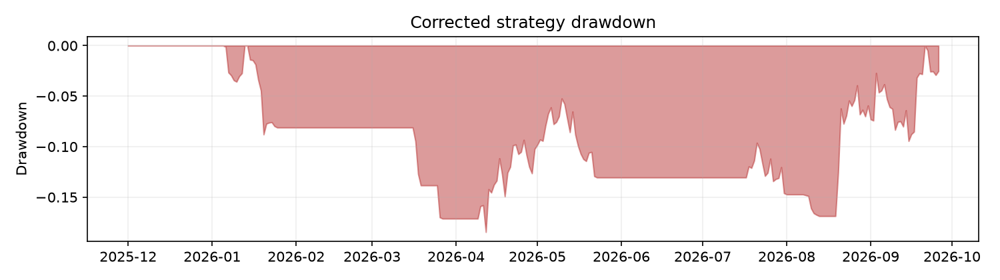

Sample project for research and demonstration only. Not financial advice. No live trading.

# Backtest Code Audit Demonstration

This small Python project shows how a code review can find common daily-bar backtest errors, demonstrate their effect with repeatable ablations, and provide a corrected implementation. The directory `flawed/` is deliberately wrong and exists only as an audit target. Do not use it for research decisions or trading.

## Current sample result

Run `python -m sample.run --offline` to reproduce the bundled, intentionally damaged 300-row candle sample. The generated detailed comparison is in [`reports/offline/report.md`](reports/offline/report.md). For the latest online run, see [`reports/online/report.md`](reports/online/report.md).

| Offline view | Total return | Max drawdown | Sharpe | Closed trades |
|---|---:|---:|---:|---:|
| Flawed equity curve, correctly measured | 21.98% | -16.82% | 1.002 | 7 |
| Corrected engine | 8.72% | -18.46% | 0.537 | 6 |
| Flawed script's self-reported metrics | 23.04% | -16.82% | 0.833 | 7 |

The headline compares the flawed equity curve and corrected strategy with one correct metric function. It lists the flawed script's self-reported metrics separately. Simulation defects change the equity curve; reporting defects (`returns`, `calendar`) change metrics only. Ablations cover simulation defects only. On BTC's continuous 24/7 daily market, the next open is usually close to the prior close, so `same_close` has little effect in this sample. On stock daily bars, overnight gaps can make it much larger. The report has the generated figures:





## Setup and commands

```bash
python3 -m venv .venv
.venv/bin/pip install -r requirements.txt
.venv/bin/pytest -q
.venv/bin/python -m sample.run --offline
.venv/bin/python -m sample.run
```

Offline mode is self-contained. Online mode fetches public BTCUSDT 1-day Binance klines from 2021-01-01 and requires network access; a request or parsing failure stops the command. It does not silently fall back to offline data and uses no API key. Output modes write to separate `reports/offline/` and `reports/online/` directories.

## Method and limits

The corrected demonstration uses a long-only EMA crossover, signals from completed daily closes, and fills orders at the next daily open. It charges a 0.1% fee per side and 0.05% adverse slippage, checks stop losses against the intraday low, and uses the opening price when a market gaps through the stop. A 30-bar warmup is excluded. Cumulative return compounds portfolio equity; annualized Sharpe uses 365 daily periods and CAGR uses elapsed calendar days.

OHLC bars cannot reveal the order of intraday price movements. The stop fill convention is a simplifying model, not a guarantee of executable price. The sample omits taxes, funding, liquidity constraints, market impact, partial fills, outages, and portfolio sizing constraints. The altered offline sample contains one missing date and a duplicate candle so the data audit has known defects to detect. This illustrates basic candle validation; it does not establish survivorship-free universe coverage. Historical results are not predictions or promises of returns.

The audit separates **simulation defects** (`lookahead`, `same_close`, `costs`, `stop`, `warmup`, `data`), which can change the equity curve, from **reporting defects** (`returns`, `calendar`), which leave the curve unchanged but distort reported statistics. Results may rise or fall when a simulation defect is fixed; the report presents measured outcomes without tuning parameters to force a direction.

## Layout

- `flawed/backtest_flawed.py`: intentionally broken audit target.
- `sample/audit.py`: reports date gaps, duplicate dates, nonpositive values, and invalid OHLC relationships.
- `sample/fixed.py`: corrected transparent bar-by-bar engine.
- `sample/run.py`: data loading, defect ablations, charts, and reports.
- `tests/`: offline unit tests with hand-calculated assertions.
- `data/sample_btcusdt_1d.csv`: 300 daily candles with one deliberately introduced missing date and duplicate.
